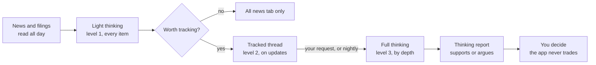

# Trading Genious product concept v1

12 November 2026 · Ilia Nevrov

## In one minute

Trading Genious is a news feed that thinks. It reads news and filings all day, marks the items worth following, links them into threads, and on your click runs a full check of every thinking layer. You make the trading decision.

- **A feed with light thinking.** Every news item gets a quick, cheap read: what happened, which companies, does it change the business, is it new. A Recommended tab shows what matters, an All news tab shows everything.
- **Tracking.** An interesting item is marked as tracked and joins a thread: a chain of linked news that builds toward a decision.
- **Thinking on click.** One button runs all layers on an idea, like tests in programming. Each layer supports the idea, argues against it, or has no opinion.
- **A record of everything.** Every idea is logged with its time and price, so after some months you can see which thinking works.

The research library and the playbook supply the evidence. This document describes the software around them.

## How it works

Every news item gets the light layer, only tracked items become threads, and only threads get the full run.



Every tracked item, thinking run and outcome goes to the log, with time and price.

The accented step is the only expensive one. It runs when you click, or for a few threads each night.

## The feed

The main page is a news feed where every item already carries a first, cheap layer of thinking. This layer runs on everything, all day, so it must stay light.

The feed has two tabs:

| Tab | What it shows |
| --- | --- |
| Recommended | Tracked items, plus news you should know about even when no thread exists yet, such as a big market event. Sorted by importance |
| All news | Every item, newest first, to read freely. Nothing here is followed unless you mark it |

| The light layer answers | Example output |
| --- | --- |
| What happened? | Event type: insider buy, analyst upgrade, supplier bankruptcy, CEO exit, lawsuit, other |
| Who is involved? | Companies and people named, plus known linked companies |
| Does it change the business? | Yes, no or unclear, with one line of reasoning |
| Is it new? | New fact, or a repeat of an older story |
| Does it match a known pattern? | Link to a playbook signal or pattern, with evidence strength |
| Did the price already react? | Price move and volume against normal, at the time of the news |

An item becomes **tracked** when at least one of these is true:

- It matches a playbook signal or a pattern from the research library.
- It links to a thread that is already open.
- It involves a company on your watchlist.
- Two cheap checks disagree, for example a big price move with no new fact.
- You mark it by hand.

Everything else appears only in the All news tab and is not followed further. Most news should end here.

## Threads

A thread is a chain of linked news aimed at one decision. Opening a tracked item shows its thread: the earlier news it connects to, why they are linked, and what the thread is waiting for.

Each thread holds:

- **The question.** What decision this could lead to, for example "reduce company A before its earnings?"
- **The chain.** News items and facts in time order, each link marked with the way it connects.
- **The current idea.** One or two sentences from the light layer: what this seems to mean so far.
- **Watch next.** The events that would confirm or break the idea, with dates.
- **A review date.** Threads close when the date passes or the question is answered.

Links come in four kinds, and the thread shows which kind each one is:

| Link kind | Meaning | Example |
| --- | --- | --- |
| Same story | A later development of the same event | Bankruptcy filing, then the court ruling |
| Company link | Customer, supplier, competitor, owner or lender | Supplier fails, customer is exposed |
| Mechanism | One fact changes costs, demand, financing or rules for another | Copper price rises, cable maker margin shrinks |
| Pattern | The situation matches a researched market behaviour | Bad news tends to keep drifting (P88) |

A new news item that fits an open thread joins it automatically and updates the current idea. If it breaks the idea, the thread says so.

## Run thinking

One button on a thread runs every layer against its current idea, the way a test suite runs against code. Each layer returns one of four results: **supports**, **argues against**, **no opinion** or **cannot tell**, with its reasons and sources.

| Layer | The test it runs | Main inputs |
| --- | --- | --- |
| Facts | Is every statement in the chain backed by a source? | Filings, articles |
| Company map | Are the links between companies real and how large? | Annual reports, supplier and customer disclosures |
| Mechanism | Does this change future money: costs, demand, financing, rules? | Facts, company map |
| Pattern | What did markets do in similar situations before? | Research library, playbook |
| Awareness | How many people already know? | News count, social mentions, search volume |
| Price and volume | What has the market already done about it? | Daily prices and volume |
| Costs and guardrails | Is the trade worth it after costs, and is this a known behaviour trap? | Spreads, your trade history |
| Conflict check | Which layers disagree, and what would explain it? | All results above |

The result reads like a test report. A made up example:

```
IDEA: Company A is exposed to the bankruptcy of supplier X

Facts              SUPPORTS        Filing confirmed. X supplies about 30% of part P (A's annual report)
Company map        SUPPORTS        Link verified. No second supplier named
Mechanism          SUPPORTS        Higher input cost or lost sales next quarter (inference)
Pattern            SUPPORTS        Supplier bad news reaches customers slowly (P83). Evidence moderate, data to 2016
Awareness          SUPPORTS        3 articles, social mentions normal: few people know
Price and volume   SUPPORTS        A is down 1% on normal volume: probably not priced in
Costs, guardrails  NO OPINION      A is a large stock, costs are low
Conflict check     NONE FOUND

6 support, 0 against. Weakest link: Mechanism (inference only).
Watch next: A's earnings call on 12 Nov, any mention of part P
```

When layers disagree, the conflict check does the most useful work. It lists the possible reasons for the conflict and what would show which layer is right. A conflict is a reason to look closer. It is not a prediction by itself.

### Suggested tag and depth

A full run takes time on any model, so the button tells you beforehand whether it is worth it. The light layer sets a tag on every thread, with one line of reason:

| Tag | When | Example reason |
| --- | --- | --- |
| Suggested | Strong pattern match, layers disagree, few people know yet, or you hold the stock | "Insider buy, low attention, no run since 3 new facts" |
| Optional | Some signal, nothing urgent | "Weak pattern, large stock, already widely covered" |
| Not worth it | Nothing changed since the last run, or the window has passed | "No new facts since last run" |

You also choose how deep the run goes:

| Depth | What runs | Use it for |
| --- | --- | --- |
| Quick | Facts, Pattern, Price and volume | A first look |
| Standard | All eight layers | A thread you may act on |
| Deep | All eight layers, full filings read, linked companies checked, and a second pass that argues against the result | A decision with real money |

The button shows an estimated time for each depth, measured from earlier runs.

## Three levels of computing effort

Computing power is spent in three levels, so the heavy analysis only runs where it matters.

| Level | Runs when | What it does | Cost per item |
| --- | --- | --- | --- |
| 1. Light | Always, on every news item | The feed questions, linking to threads | Small: one short model call |
| 2. Thread update | When a new item joins a tracked thread | Rewrites the current idea and the watch list | Medium |
| 3. Full thinking | When you click, on one thread | All eight layers and the report | Large: many model calls and data lookups |

Two additions keep the click only design from hurting the product:

- **Snapshot at news time.** Level 1 saves the price, volume and facts at the moment of the news. A full run days later can then still judge the idea as of that moment. This matters because signals pay out fast: from 2005 to 2019, half the return came in the first two weeks (P3512).
- **A small nightly budget.** The machine is idle at night. It can run full thinking on the few strongest tracked threads without a click. This also keeps the track record fair: if only clicked ideas are logged, the record shows your taste and not the system's skill.

## Memory and caching

The model never reads the whole history. It reads a short summary plus the few facts it looks up, so a run stays fast no matter how old the system is. Everything lives in a database, not in loose files.

| Store | What it holds | Kept for | Read by the model? |
| --- | --- | --- | --- |
| Log | One small row per tracked item, run and outcome | Forever, never edited | No. Only the track record screen reads it |
| Thread summary | A short rolling summary, rewritten at each update, with a fixed maximum length | While the thread is open | Yes, this is the main input |
| Fact store | Small dated statements with sources, searchable by company | Long term | Only the facts looked up for this thread |
| Run cache | Each layer's last result and the inputs it used | Until its inputs change | A rerun repeats only the layers whose inputs changed |
| Evidence cards | Signals, patterns and papers | Fixed | Only the cards that match |
| Working text | Raw model output and drafts from runs | Deleted after a set number of days | No |

A closed thread keeps its summary and outcome and drops the rest. This keeps the honesty rule intact: the log is permanent, the working memory is erasable.

## Honesty rules

Five rules keep the thinking trustworthy, because a language model can write chains that sound right and are wrong.

1. **Every statement carries a label.** Fact (with its source), research backed (with the paper), or inference (the model's own logic).
2. **No invented numbers.** A chance or expected move is shown only when it comes from history, with the sample size and the years.
3. **Long chains are flagged.** If each link is 80% likely, a chain of five links holds about one time in three. The report shows the number of links and the weakest one.
4. **The price layer gets respect.** When the reasoning and the market disagree, the report says the market may know something the app does not.
5. **Everything is logged and never edited.** Idea, time, price, layer results, and later the outcome.

The app shows evidence and reasoning. It does not say buy or sell.

## Screens

Six screens cover the whole product, and the first three are enough for a first version.

| Screen | What you see | First version |
| --- | --- | --- |
| Feed | Two tabs, Recommended and All news, with the light layer shown and filters by company and event type | Yes |
| Thread | The question, the chain of linked news, the current idea, watch next, the Run thinking button | Yes |
| Thinking report | Layer by layer results, labels, conflicts, weakest link | Yes |
| Company | Everything about one company: open threads, links to other companies, recent events | Later |
| Evidence library | Signals, patterns and papers, with strength and age of the evidence | Later |
| Track record | How each signal, pattern and layer performed since logging began | Later, but logging starts on day one |

## Delivery and scaling

The engine is built once as a service with a database and an API, and every interface is a thin client on top of it. That way a Telegram start does not have to be rebuilt when an app comes later.

| Part | Role | When |
| --- | --- | --- |
| Engine | Intake, light layer, threads, thinking runs, log. One service, one database, one API | First |
| Run queue | Thinking runs wait in line, so many requests do not overload the machine | First, even for one user |
| Telegram channel | The Recommended feed, open for everyone to read | First interface, private at the start |
| Telegram private bot | Send it a news item, choose a depth, get the thinking report. For subscribers | After the channel |
| Web or mobile app | Both feed tabs, threads, reports, track record | Later |

Three design choices make a subscription workable:

- **Shared runs.** A thinking run on a thread gives the same result for everyone, so it runs once and is served to all who ask. Only personal parts, such as your watchlist and your own trade history, are computed per user.
- **Credits by depth.** Each run has a measured cost, so a plan can state exactly what a subscriber gets: so many Quick, Standard and Deep runs a month.
- **Users from day one.** Every watchlist, click and run is stored with a user id, even while you are the only user.

Two checks before charging anyone:

- **News rights.** Post your own summary with a link to the source. Reposting article text usually needs a licence.
- **Financial rules.** Paid analysis of single stocks can count as investment recommendations under EU rules, supervised in the Netherlands by the AFM. Get one legal check first.

## First version and build order

The first version proves the whole loop on a small scale: feed, tracking, one thread, a Quick thinking run, and the log.

1. **Intake.** Company announcements, director dealing registers and one news source for four markets: the Netherlands, Germany, France and the United Kingdom. No watchlist limit. Save every item with its timestamp and the size of the company.
2. **Light layer.** The six feed questions on every item, with the price and volume snapshot.
3. **First interface.** A private Telegram channel for the Recommended feed. It reads from the engine API, so a web or mobile app can follow later.
4. **Threads.** Start with two link kinds: same story and pattern. Insider buying is the first pattern, since it has the strongest evidence and free data. In Europe these filings are called director dealings.
5. **Run thinking at Quick depth.** Facts, Pattern, Price and volume. The report format is final from the start, with the other layers shown as "not built yet".
6. **Log.** Every tracked item and every thinking run, from day one.
7. **Then add, one at a time:** company map, mechanism layer, conflict check, costs and guardrails, the remaining screens.

Research round 3 can run next to steps 1 to 6. Its results feed the Pattern layer and the company map, which come later in the build.

Before step 1, one test by hand: take three real news events from this week and write the thread and the thinking report for each. This shows which parts are easy to automate and which need data you do not have yet.

## Decisions

Decided and open points are kept in [decisions.md](decisions.md).
